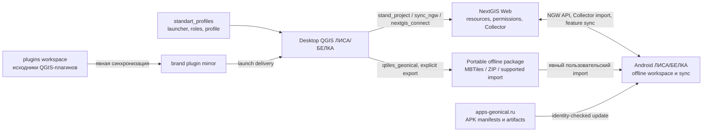

# Экосистема ЛИСА — desktop, плагины и Android

## Обнаружение зависимостей до правки

Перед любым изменением поведения, API, данных, ресурсов или конфигурации агент
самостоятельно выполняет discovery всего доступного desktop/mobile source-контура,
затем разбирает затронутое замыкание в обе стороны. Registry, условие «это задача
на границе» и перечисленные пользователем цепочки не заменяют поиска.

Единственный общий механизм находится в LISA tooling: модуль
`tools.ecosystem_tests.dependency_discovery`, source index
`plugins/geonical-docs/registry/discovered-dependencies.json` и процедура
`plugins/geonical-docs/guides/scenario-dependencies.md`. Registry links —
`ECO-DEPENDENCY-DISCOVERY` в [ecosystem.yaml](../registry/ecosystem.yaml).
Android не хранит копию scanner/index и не делает их runtime-зависимостью APK.

Сначала определить доступный внешний `qgis-plugins` source root по
`docs/registry/ecosystem.yaml` (location/current_machine_path), прочитать общий
guide и проверить реальное расположение/ревизии владельцев. В обычном LISA
checkout из его корня выполняются read-only команды:

```powershell
py -3.13 -B -m tools.ecosystem_tests.dependency_discovery
py -3.13 -B -m tools.ecosystem_tests.dependency_discovery --check
py -3.13 -B -m tools.ecosystem_tests plan --changed android_projects/android_gisapp/app/src/main/java/com/nextgis/mobile/MainApplication.java
```

Для явного другого LISA source root discovery принимает `--workspace PATH`.
Он анализирует source contour выбранного root: отдельный Android worktree
автоматически не становится частью этого контура. Сравнить actual owner roots/
revisions; индекс другой ветки/копии не подтверждает текущее дерево. Если нужный
LISA/owner root недоступен, сабмодуль не получен, scanner не поддерживает источник
или actual root/revision не покрыт, сохранить UNKNOWN с источником/следующим шагом.
Продолжить доступный локальный поиск и owner registry/evidence; не придумывать
PASS, не инициализировать чужие сабмодули и не дублировать общий индекс для обхода.

Все новые подтверждённые связи сохраняются в той же задаче без отдельной команды:
синтаксические — через shared discovery `--write`, смысл/условия/ограничения —
в curated owner contracts. Ambiguous candidates и unresolved dynamic refs
сохраняются с source location, статусом и следующим шагом, а не отбрасываются.
Перед source commit обновить/проверить общий индекс по текущим исходникам и
повторить impact при изменении границ. Не перегенерировать независимые ожидания
под текущую ошибочную реализацию. Компактное evidence — в существующей карточке/PR.

Обязательно проверять PostgreSQL → desktop layer → mobile config → NGW/Collector
→ Android consumer и обратное направление; это пример, а не полный список.
Новые связи агент находит сам. Dirty/чужой owner checkout блокирует его правки,
но не исключает обязательный follow-up и порядок доставки. Выполненный статический
анализ не является native/NGW/DB/device приёмкой, не разрешает AVD, публикацию,
server writes или возобновление остановленных этапов. AUTO-DOCS-VALIDATE проверяет
структуру/ссылки app-side registry; это не автоматическое доказательство свежести
shared source index или полноты смыслового разбора.

## Статистика мобильного приложения

Отдельная интеграция связывает production Android с HTTPS сервисом
`apps-geonical.ru/mobile-stats/`, owner `C:\dev\lisa\server\mobile_usage`.
Собираются устройства, WebGIS accounts/projects и даты открытий, с offline
outbox и точными ACK. Длительность работы не собирается. NextGIS Web, данные
объектов и desktop tenant DB не меняются. [Контракт](mobile-usage.md).

## Владение

Фоновой загрузкой APK владеет Android `app`: тот же опубликованный manifest и
versioned APK подготавливаются через WorkManager по сети без роуминга. Серверный
формат, NGW/Collector и desktop-профили не меняются. Установка начинается только
по кнопке «Обновить» в открытом приложении; [контракт](../runbooks/release-apk.md).

| Система | Канонический источник | Ответственность |
|---|---|---|
| Desktop profile | `C:\dev\lisa\standart_profiles` | launcher/bootstrap, QGIS runtime, бренды, роли, эталонный профиль и доставка |
| QGIS Plugins | `C:\dev\lisa\plugins` | исходники плагинов, desktop workflows, подготовка и публикация GIS-ресурсов |
| Android Mobile | этот workspace | полевой клиент, локальное GIS storage, NGW/Collector import и sync, APK release |

`profiles/*/python/plugins/` внутри `standart_profiles` — deployment mirrors, а
не четвёртый источник кода. Изменение плагина выполняется и проверяется в
Plugins workspace, затем отдельно доставляется в desktop profile.

## Поток

Поведение NGFP передаётся через собственные блоки meta.json: каскадные списки,
обязательность и видимость. `lisa_form_rules` v2 позволяет скрывать поля и
элементы по тем же условиям, что и required, сохраняя значения и версию правил
черновика. Новый APK устанавливают до обновления формы; облачный UI может не
показывать эти настройки. [Контракт](conditional-form-rules.md) и
[инструкция пользователя](../guides/form-behavior-user-guide.md).



Desktop и Android не обмениваются рабочими файлами напрямую. Основная
интеграционная граница — NextGIS Web; offline package является осознанным
переносимым артефактом, а не ссылкой APK на desktop workspace.

## Межпроектные контракты

### NGW/Collector resource

QGIS-инструменты могут создавать, оформлять и синхронизировать ресурсы,
которые затем открывает Android. Совместимыми должны оставаться:

- server URL и стабильная resource identity;
- тип ресурса и дерево ссылок Collector;
- schema полей, права `data.read`/`data.write` и sync direction;
- стили, формы, composition и lifecycle управляемых слоёв;
- различие между server-managed ресурсом и локальной immutable `.ngrc`-подложкой;
- поле `district` у объектов — список `basic.districts.name` через запятую с
  пробелом; `resmeta.items.district` Collector-проекта — один ключ, который
  Android ищет как вхождение (`fld_district__like`), а не как равенство строки;
  несинхронизируемые слои (`SYNC_NONE`) сверяют отфильтрованный count и при
  расхождении (сервер > 0) пересобирают слой;
- корневая группа каталога полевых проектов имеет `keyname=lisa` (Lisa и Belka);
  Android показывает Collector-проекты внутри этой группы пунктом «Загрузить проект».

В publisher-режиме `vector_only` управляемые `sync_ngw` слои могут содержать
служебное `idqgs BIGINT`. Оно связывает web-объект с первичным `id` PostgreSQL для
одностороннего обновления сервера. Publisher включает `idqgs` в mobile `fields[]`
как `LONG` (`type: 13`), чтобы локальная SQLite-схема совпадала со схемой NGW и
не вызывала повторную перестройку слоя. Колонка в PostgreSQL и изменение
Android-кода не требуются; слой остаётся нередактируемым, контрактное направление —
только NGW → Android.

Выкладка начинается на publisher-side: `stand_project` публикует mobile configs
в `vector_only` с полем `idqgs`. Android независимо сверяет authoritative NGW
resource class/geometry/fields с serialized config и физической SQLite. Если
NGW и SQLite уже содержат `idqgs`, устаревший description чинится как metadata
без скачивания слоя. Ошибочный vector/PostGIS class также чинится как metadata;
refill допустим только при несовпадении geometry или физической таблицы и
публикуется атомарной заменой.

Временный HTTP `5xx` или `ExternalDatabaseError` внешней БД не изменяет этот
контракт и не превращает серверный слой в локальный. Android откладывает только
упавший pull до второго прохода синхронизации, не повторяя уже успешные слои.
Pending локальные изменения отправляются до большого pull; при ошибке push
remote snapshot не применяется. Publisher-side изменений для
такого восстановления не требуется.

Изменение publisher-side логики в `stand_project`, `sync_ngw`,
или `nextgis_connect` требует consumer-smoke в Android, если меняется этот
договор. Внутренний refactoring плагина без изменения ресурса
Android-документацию не затрагивает.

### Offline basemap artifact

QTiles заменяет существующую подложку только после подтверждения и успешного
экспорта; отмена/ошибка сохраняет прежний MBTiles. Переносится готовый файл,
а не временные `.qtiles-*.mbtiles`. Android schema/importer, CRS и zoom прежние.

`qtiles_geonical` создаёт raster MBTiles/ZIP на desktop и не публикует результат
в NGW автоматически. Передача в Android — отдельное явное действие пользователя
или release-процедуры. Android consumer принимает raster MBTiles с таблицами
`tiles`/`metadata`, Web Mercator tile matrix, поддерживаемым image format и
согласованным zoom/bounds; vector MBTiles этим контрактом не покрывается. Путь к
файлу в desktop workspace частью контракта не является. Нельзя подменять smoke
фактического Android import утверждением, что QGIS успешно создал файл.

### Идентичность и секреты

Desktop credentials, `variables.py`, QGIS auth DB, Android AccountManager и
signing credentials принадлежат разным trust boundaries. В документации
фиксируются имена ключей, server/resource identity и способ проверки, но не
секретные значения. Наличие рабочего desktop login не доказывает, что Android
account type, permission или token настроены правильно.

### Независимый выпуск

`standart_profiles` доставляет desktop profile и плагины; он не доставляет APK.
Мобильный release публикуется независимо и проверяет flavor, application ID,
version, artifact hash и signing certificate. Совместимость с серверными
ресурсами подтверждается отдельным end-to-end smoke, а не совпадением названия
версии desktop и Android.

Различия Android PackageManager не изменяют эту границу доверия: на Android
9–10 updater может получить сертификат archive APK из legacy `signatures`, если
современный `SigningInfo` пуст, но всё равно сравнивает тот же SHA-256 с manifest
и установленным пакетом. Desktop credentials и publisher к этой проверке не
привлекаются.

## Маршрутизация задачи

| Изменение | Проект-владелец | Дополнительный контекст |
|---|---|---|
| launcher, QGIS runtime, role, brand profile | `standart_profiles` | его `AGENTS.md` и `docs/START-HERE.md` |
| исходник QGIS-плагина или WebGIS publisher | `C:\dev\lisa\plugins` | root `AGENTS.md`, `geonical-docs/START-HERE.md`, pack плагина |
| Android import, Collector, sync, storage, updater | этот workspace | root/module `AGENTS.md`, Android registries |
| общий NGW resource contract | publisher и consumer | docs/registry обоих владельцев + end-to-end smoke |
| offline basemap для Android | QGIS plugin + Android importer | qtiles pack, app rendering/storage docs и import smoke |

На текущей машине соседние входы находятся в
`C:\dev\lisa\standart_profiles\docs\START-HERE.md` и
`C:\dev\lisa\plugins\geonical-docs\START-HERE.md`.
Канонические web-входы:
[standart_profiles](https://github.com/GeonicalSys/standart_profiles/blob/main/docs/START-HERE.md)
и
[geonical-docs](https://github.com/GeonicalSys/geonical-docs/blob/main/START-HERE.md).

Точные IDs и проверяемые пути: [ecosystem.yaml](../registry/ecosystem.yaml).

## Правило изменения

1. Определить publisher, consumer и фактически изменяемый контракт.
2. Читать инструкции и registry каждого затронутого владельца.
3. Менять код только в его каноническом source workspace.
4. Обновить app-side `ecosystem.yaml` и основной документ владельца, если
   изменилась внешняя семантика.
5. Выполнить локальные проверки обоих проектов и end-to-end NGW/Collector smoke
   либо явно зафиксировать, что он не выполнен.

Не делать вывод о совместимости по plugin mirror, совпадающему имени слоя,
успешному desktop login или одной только Android-сборке.

## Доставка правил проекта

`stand_project` публикует source-only ZIP во вложение нового native vector_layer
и ссылку в Collector. Android не читает desktop-диск: `maplib` владеет форматом,
изолированным QuickJS и native API, `maplibui` — формой, `app` — lifecycle guard.
[Project scripts](project-scripts.md) и `ECO-PROJECT-SCRIPTS` фиксируют границу.
GIS/расчётные функции расширяются постепенно в APK, без arbitrary SQL/сети в JS.
